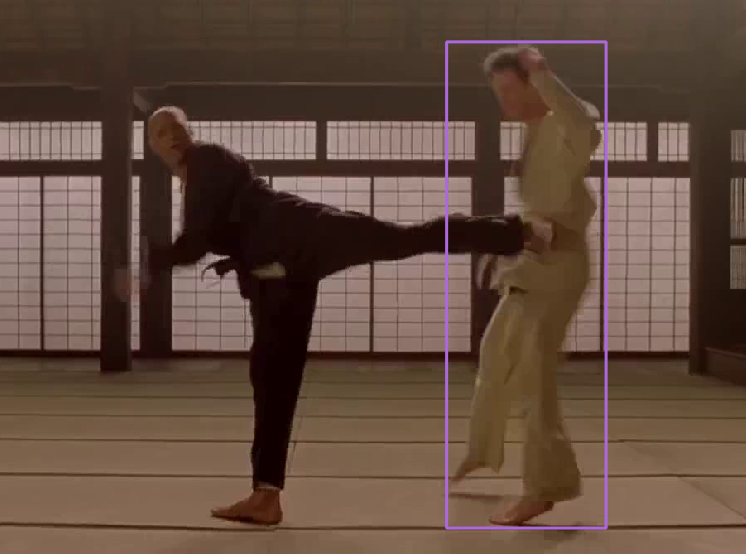
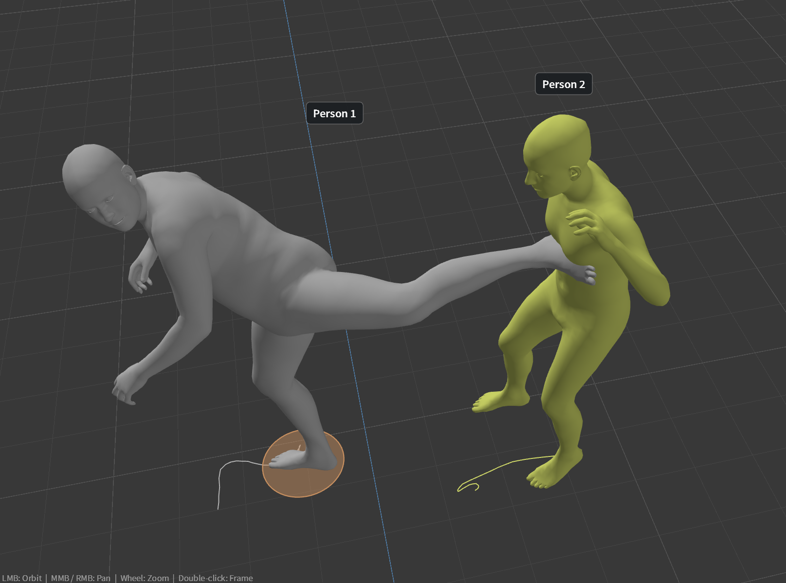
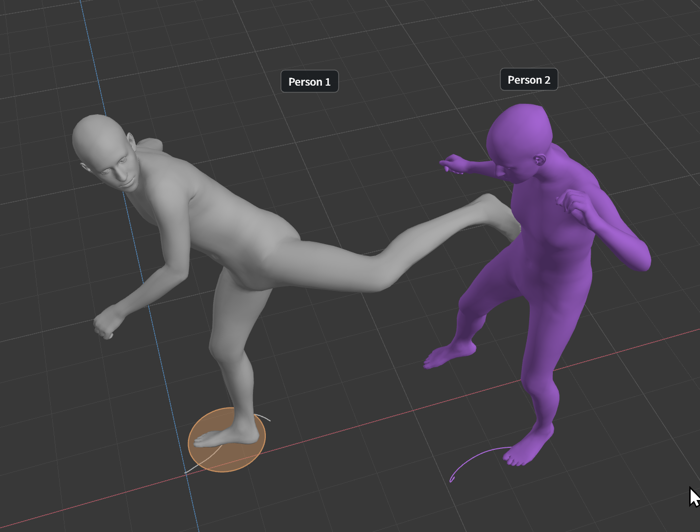

# PromptHMR

[Model index](README.md) · [User guide](../USER_GUIDE.md) ·
[Official project](https://yufu-wang.github.io/phmr-page/) ·
[Official code](https://github.com/yufu-wang/PromptHMR)

PromptHMR reconstructs multiple people together from a **single video**. In our
subjective tests, it could reproduce relative positions and interactions more
accurately than independently reconstructed actors, but its **overall motion
quality was lower than ExMR**. It **does not support finger tracking**; the app
uses a fixed neutral finger pose. These observations are not a universal accuracy
ranking. Depth errors, sliding, identity changes and body intersections remain
possible. Interaction Prompt does not create a contact lock.

## Single-video interaction example

The input frame shows a kicking foot contacting the other person's torso.
The supplied reconstructions illustrate how the models place the two people
relative to each other.

**Input video frame**

| PromptHMR | ExMR |
| --- | --- |
|  |  |

In this example, PromptHMR more closely reproduces the foot-to-torso contact
visible in the input, while ExMR leaves a different relative placement at the
contact point. This is a qualitative example, not a measured contact-accuracy
benchmark. The viewport angles differ, and the images do not establish an exact
3D contact distance or guarantee similar results on other footage.

## Install the separate runtime

Keep PromptHMR separate from the base installation. Its package versions and
local SAM2 CUDA build need their own environment, compiler tools and license
review. A PromptHMR setup failure must not prevent the base models from working.
`install.cmd` prepares ExMR/FlowHMR/GVHMR; it does not install PromptHMR or MAMMA.

1. Complete `install.cmd` for the base app.
2. Install [Visual Studio 2022 Build Tools](https://visualstudio.microsoft.com/downloads/)
   with **Desktop development with C++** and the Windows SDK, plus
   [CUDA Toolkit 12.8](https://developer.nvidia.com/cuda-12-8-0-download-archive).
   The NVIDIA driver alone does not include the compiler.
3. Close RGB MoCap and run `Setup_PromptHMR.cmd`. Review the provider license
   prompt. In Command Prompt, run `Setup_PromptHMR.cmd` from the app folder
   (PowerShell: `.\Setup_PromptHMR.cmd`). Setup downloads pinned sources/packages,
   builds SAM2 for the installed
   GPU and verifies real CUDA operations before registering the environment.
4. Reopen the app, select **PromptHMR**, and prepare every file in **Model Manager**.
   Google Drive may require a manual browser download; use **Manual Download... >
   Import** if automatic downloading fails. **Runtime Setup...** shows instructions
   and copies the command; it does not install anything inside the running app.
   A runtime already marked Ready does not need reinstalling before each use.

The setup report measured **6.32 GiB** on the test PC, excluding weights and
compiler tools. The later active-runtime inventory excluding caches measured
**6.22 GiB**. Package downloads total about **3.55 GiB**. Allow approximately
**18 GiB free during setup**, excluding models and compiler tools. Retained
download archives and project intermediates need additional space.

PromptHMR-specific models/support files total approximately **6.09 GiB**,
excluding the registered body files below. Standard SMPL-X Neutral is shared
with ExMR/GVHMR. SMPL Neutral is also required by PromptHMR; it is optional
for the three base workflows. Both live in `models/body_models/`. Import those licensed files
if absent; they are not bundled. MAMMA's locked-head body cannot substitute.
Adding PromptHMR to a complete base installation measured **6.13 GiB** of model
files including SMPL Neutral, plus **6.22 GiB** of cache-free runtime, for about
**12.34 GiB additional**. See the [all-model inventory](../USER_GUIDE.md#installed-size).
PromptHMR's ViTPose COCO-25, SAM2 tiny and detector checkpoints differ from
similarly named files in other workflows. Imports verify the supported hashes.

Select **PromptHMR > Model Manager** for the complete 14-file checklist. Locations
below are relative to `models/`; obtain the exact files listed by the manager.

| Component | Files or folder |
| --- | --- |
| Image model and configuration | `prompthmr/pretrain/phmr/checkpoint.ckpt`, `config.yaml` |
| Video model and configuration | `prompthmr/pretrain/phmr_vid/prhmr_release_002.ckpt`, `prhmr_release_002.yaml` |
| Tracking detector / masks | `prompthmr/pretrain/keypoint_rcnn_5ad38f.pkl`, `sam2_hiera_tiny.pt` |
| Keypoints / camera calibration | `prompthmr/pretrain/vitpose-h-coco_25.pth`, `camcalib_sa_biased_l2.ckpt` |
| Body correspondence / means / regressors | Four files under `prompthmr/body_models/`, listed individually in Model Manager |
| Registered standard bodies | `body_models/smplx/SMPLX_NEUTRAL.npz`, `body_models/smpl/SMPL_NEUTRAL.pkl` |

On one volume, the connector hardlinks verified weights into the private engine
without storing another copy. If hardlinks are unavailable, it reports the copy
and uses extra disk space. Installed Python packages remain separate.

This profile uses Python **3.11.17**, Torch **2.7.1+cu128**, torchvision
**0.22.1+cu128**, NumPy **1.26.4** and timm **0.9.0**. Torch overlaps with other
profiles, but Python ABI/package requirements differ. Installed packages remain
isolated for update safety; identical verified MAMMA download archives can be
reused. The current locks share 147 identical package archives, about 3.39 GiB
of downloads. This does not mean installed packages can safely be merged.
MAMMA and SDF are not required. Do not combine these environments.

`install.cmd`/`update.cmd` leave PromptHMR optional. A changed PromptHMR runtime
lock prompts for `Setup_PromptHMR.cmd`; other runtimes/projects are preserved.

### Update or repair

Close RGB MoCap before `update.cmd`. After updating, rerun `Setup_PromptHMR.cmd`
only when its runtime is missing, needs repair or the app reports changed
dependencies. It verifies and retains a matching environment, or prepares a new
generation before switching to it. Keep models, projects and `.setup` state.

If setup fails, read the last CMD error and the corresponding
`.setup/logs/prompthmr-*.log`. Check free space and the documented C++/CUDA tools;
then retry the same setup. If weights are Missing, use Model Manager instead
of rebuilding the runtime. If native GPU verification fails after moving to
another GPU architecture, run setup on that PC; do not copy compiled modules
from an arbitrary machine or edit registration files to mark them Ready.

## Controls and supported workflow

- **One fixed-camera video**, without camera movement or zoom. Moving-camera
  DROID is not implemented in this Windows integration.
- **People** defaults to **2**. **0** detects automatically, up to eight. This is
  a maximum count, not an identity selector. The intended people should be
  visible near the start; background people and occlusion can confuse tracking.
- **Interaction Prompt** defaults on, asking the image model to consider people
  together. Off follows the official default video path. On was not uniformly
  better in our comparison. Changes apply on reconstruction.
- Click **Reconstruct 3D**. PromptHMR performs SAM2 tracking itself; **Find person**
  is hidden. Image/video inference, gravity/world placement and native
  post-optimization are retained. The app does not independently space or
  rescale actors. Progress/activity and cancellation use the normal worker UI.
- SMPL-X body motion is generated. The official video settings used here
  **do not generate animated fingers**. Missing zero-matrix hand placeholders
  are replaced with the registered body's fixed relaxed hand pose. Hand contact
  correction is not finger inference.
- Check People rows to show/hide actors and select a row to edit contacts.
  **Enable Correction** switches original/corrected motion. **Apply Correction**
  does not rerun PromptHMR and refreshes linked characters. Correction may
  intentionally change poses. Export through **File > Export FBX**, or retarget
  to an imported character.

The working video is sampled at 30 fps. The current adapter accepts **4–1,800
working frames** and **up to eight people**. Available RAM/VRAM may require less.
These are app limits, not claimed upstream limits. Long unobserved absences are
not displayed as stationary poses or replaced with another actor.

Both Automatic and Low Memory keep the validated **one-image batch**, model
precision, full temporal context and native post-optimization. Additional
PromptHMR block offloading is not implemented. Actual RAM/Windows allocation
headroom monitoring, CUDA allocator budgets and allocation-error reporting remain
active. Low Memory is not a promise of a smaller PromptHMR footprint; trim or
close other GPU applications when needed.

Windows adapters retain strict checkpoint loading, avoid discarded initialization
downloads, and replace a failing xFormers decoder kernel with PyTorch SDPA.
Verification on one RTX 5090 PC is not full Linux-output equivalence or
other-GPU validation. Setup tests SAM2 connected components, torchvision CUDA
NMS and native attention on the user's GPU.

## Recorded validation

A 422-frame, 14.1-second, two-person fixed-camera clip completed in **3 min 56 sec**
on the documented RTX 5090 test PC, with Interaction Prompt and app correction
enabled. Preparation took 4.8 s; tracking 73.5 s; camera/keypoints/motion 103.0 s;
world/post-optimization 33.0 s; correction/preview/bone preparation 21.9 s.
Peak worker working set was **8.74 GiB**. Peak PyTorch allocated VRAM was
**4.61 GiB**, with **7.83 GiB reserved**; total GPU use can be higher. These are
one-run observations, not minimum requirements or a direct speed ranking against
other models. Public FBX writing was checked separately.

Original/corrected motion for both actors was exported and imported into Blender
as 52-bone rigs with bone-only animation and separate rest transforms. Save As,
reopening and Mixamo character retargeting passed. Native playback had no sampled
video/timeline frame mismatch during a short 12-second check; frame-swap intervals
were 31 ms median, 47 ms at the 95th percentile and 47 ms maximum. Three repeated
opens kept handle/thread counts stable. This short check does not establish
universal playback performance or leak freedom. Fresh two-second inference/export
smoke tests also passed for ExMR, FlowHMR and GVHMR. See [validation](../VALIDATION.md).

### Refreshing older finger poses

Earlier results could contain a fixed, severely curled hand: the upstream video
path filled missing finger rotations with zero matrices, which became 120-degree
rotations during axis-angle conversion. The app now treats these as missing
hands and uses a fixed registered-neutral pose. Native inference files remain
unchanged; this is not newly inferred finger animation.

For an existing result showing the legacy notice, keep the original video,
models and settings, then **Reconstruct 3D**. A verified native inference cache
is reused and the app republishes motion, correction and export previews; a
missing or changed cache can require inference. **Prepare Preview** alone does
not replace already published hand parameters. No runtime reinstall is needed.

Two short two-person clips (32 and 85 frames) were checked. Body/root/shape and
corrected-body tensors remained exact, body/wrist joint positions were unchanged,
and four Blender FBX imports retained fixed local finger rotations.

## Files and agent/developer guide

| Item | Location |
| --- | --- |
| Weights | `models/prompthmr/`, shared `models/body_models/` |
| Runtime | `runtime_prompthmr/<generation>/` |
| Runtime registration | `.setup/prompthmr-runtime.json` |
| Setup logs / retained archives | `.setup/logs/prompthmr-*.log`, `.setup/prompthmr-downloads/` |
| Native inference | `<project>/prompthmr/inference/<generation>/results.pkl` |
| Published actors/takes | `<project>/prompthmr/results/<generation>/` |
| Lock / Windows adaptations / CUDA verification | `installer/prompthmr-runtime-lock.json`, `installer/prompthmr_adapters.py`, `installer/verify_prompthmr.py` |
| Setup implementation | `tools/setup_prompthmr.py` |
| App connector | `mocap/prompthmr_pipeline.py`, `prompthmr_publish.py`, `prompthmr_scene.py`, `prompthmr_ui.py`, `prompthmr_runtime.py` |

Native inference, derived correction and export generations remain separate.
Cancelled/incomplete new work does not replace the saved active project. Verified
complete inference can be reused; changed models/inputs/adapters invalidate it.
Tracking/mask intermediates can be much larger than final motion. Do not delete
files from saved projects to repair them, or edit a ready runtime in place.

For agent-assisted setup, ask: “Read AGENTS.md and docs/models/PROMPTHMR.md.
Check Windows C++/CUDA prerequisites, run Setup_PromptHMR.cmd after my required
license review, verify its CUDA checks and help import the exact model files.
Preserve the other runtimes, models and projects.” Do not put credentials in chat.

## License

[PromptHMR's license](https://github.com/yufu-wang/PromptHMR/blob/main/LICENSE)
restricts use to non-commercial scientific research. RGB MoCap's MIT license
does not relicense it, supporting checkpoints or registered body data. Restricted
source is downloaded into the user's private runtime; weights/body models are not
bundled. SAM2, Detectron2, ViTPose and other components retain their own terms.
